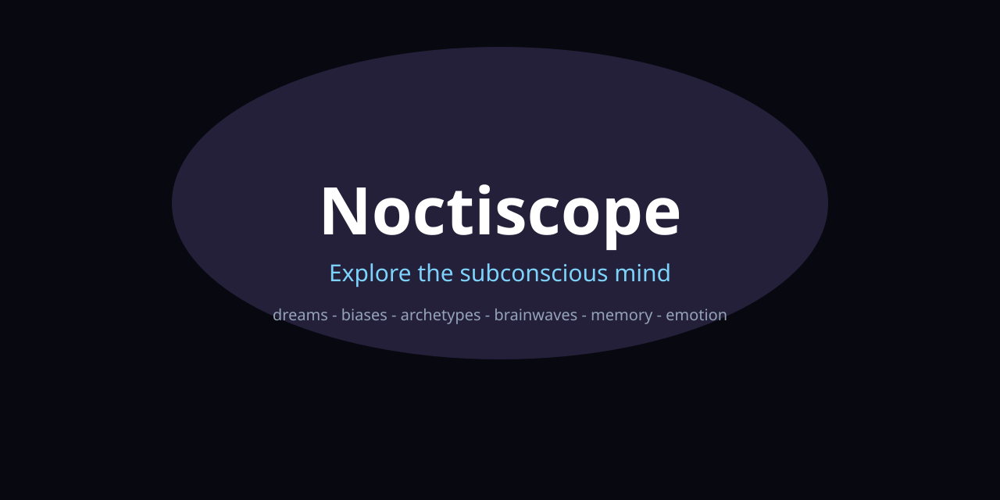

<div align="center">
  
  <h1>Noctiscope — Explore the Subconscious Mind</h1>
  <p>An interactive observatory for psychology, neuroscience and everything happening in the subconscious.</p>
  <p>
    
    
    
  </p>
  <b>Zero API keys needed — every "AI" is a deterministic local simulation.</b>
</div>

---

## What is Noctiscope?

Your brain runs a night shift you never see: the amygdala scanning for danger, the hippocampus filing
memories, the default mode network wandering, dreams rehearsing fears. Noctiscope makes that shift
visible — twelve interactive labs in one Next.js app, all simulated deterministically from seed 7331.

Why it should exist: psychology textbooks are static, neuroscience papers are gated, and dream apps want
your data. Noctiscope is open, offline-capable, and honest about being a teaching simulation.

## What you can do with it

| I want to… | Open | Get |
|---|---|---|
| See what each brain region whispers | `/atlas` | 12 regions + reflection prompts |
| Decode last night's dream | `/dreams` | symbols, valence/arousal, lucid prompt |
| Catch my own biases | `/biases` | 18 experiments + debias rituals |
| Meet my inner cast | `/archetypes` | 12 Jungian archetypes + shadows |
| Poke my neurochemistry | `/neurochem` | dopamine/serotonin/cortisol/oxytocin sim |
| Spot my defenses | `/defenses` | 8 Freudian defenses + healthier moves |
| Map my sleep | `/sleep` | 90-min cycles + trance states |
| Memorize anything | `/memory` | method-of-loci palace builder |
| Name a feeling to tame it | `/emotions` | affect labeling + breathing protocol |
| Journal with a mirror | `/journal` | deterministic reflection, zero keys |
| Watch brainwaves | `/brainwaves` | delta→gamma live sim |
| Replay a mental day | `/timemachine` | event-sourced state replay |
| Take a mind quiz | `/quiz` | big-five, chronotype, stress index (saved locally) |
| Search everything | `/search` | regions, symbols, biases, archetypes in one query |

## Quickstart

```powershell
git clone https://github.com/aniruddhaadak80/noctiscope
cd noctiscope
bun install
bun scripts/seed.ts
bun run dev
```

Docker: `docker compose up --build`. Deploy: `bunx vercel --prod`.

## How it works

1. Enter any lab (`/dreams`, `/biases`, …) — all client-rendered, no account.
2. Core loop: input → `@repo/core` pure function (seeded) → narrative + ritual.
3. Under the hood: zod-validated route handlers delegate to dependency-free domain logic; the
   Python FastAPI service optionally mirrors reflection; the Rust crate mixes brainwaves.
4. Time machine replays `MENTAL_TIMELINE` event by event — your mind as event sourcing.

## Architecture

```mermaid
%%{init: {'theme':'base', 'themeVariables': {'primaryColor':'#a78bfa','primaryTextColor':'#fff','lineColor':'#7dd3fc','background':'#070810'}}}%%
flowchart LR
  subgraph client[apps/web]
    UI[App Router pages] --> API[Route handlers /api]
    UI --> CORE_WEB[@repo/core in browser]
  end
  subgraph pkgs[packages]
    CORE[@repo/core pure logic] --> SEED[@repo/seed datasets]
    UI_PKG[@repo/ui design system]
    SDK[@repo/sdk typed client]
  end
  subgraph poly[polyglot]
    PY[services/agents FastAPI]
    RS[crates/engine Rust]
    RB[bin/pipeline.rb]
    PL[bin/xtract.pl]
  end
  API --> CORE
  CORE_WEB --> CORE
  SDK --> API
  PY --> API
  RS --> CORE
```

More diagrams: `docs/diagrams/` (13 `.mmd` sources: request flow, ERD, agent lifecycle, CI/CD,
user journey, mindmap, gitGraph, gantt, class, quadrant, infra, sleep cycle).

## The scale engine

Deterministic generators (`scripts/generate.ts`, seed 7331) grow glossary docs, guides, i18n catalogs
(14 locales), seed worlds, symbol routes, and contract tests. Measure:

```powershell
bun scripts/generate.ts --mega
bun scripts/loc-count.mjs
```

```
Scale report (2026-10-12, seed 7331)
  code lines : 5,429 in ~140 files (TypeScript strict, all typechecked + linted + tested)
  total lines: 1,047,124 in 590 files (verified via scripts/loc-count.mjs --json)
  top layers : packages/seed CSV worlds ~1.02M · docs ~9k · i18n 14 locales ~6.7k
```

Design note (ADR-004): bulk lines live in offline seed corpora, docs, and i18n catalogs so
`next build` stays green; every generated TypeScript module is typechecked and every generated
route is statically prerendered.

## Documentation map

| Doc | Path |
|---|---|
| Diagrams | `docs/diagrams/*.mmd` |
| ADRs | `docs/adr/` |
| Deploying | `docs/guides/deploying.md` |
| LLM upgrade | `docs/guides/llm-upgrade.md` |
| API | `docs/api/reference.md` |
| Green gates | `docs/runbooks/green-gates.md` |

## Contributing

See `CONTRIBUTING.md`. Conventional Commits, one change per commit, gates must pass.

## License

MIT © Aniruddha Adak
